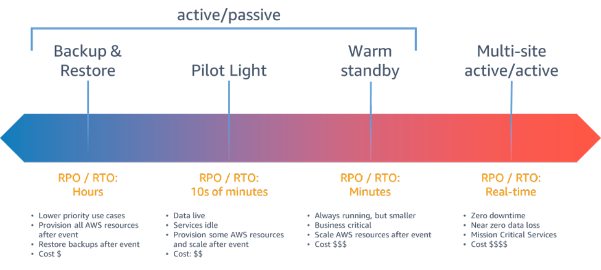

# Disaster Recovery on AWS: A Practical Field Guide

A structured, practitioner-focused breakdown of AWS disaster recovery strategy, based on the AWS Well-Architected whitepaper "Disaster Recovery of Workloads on AWS: Recovery in the Cloud". Written for architects, technical programme leaders and engineering managers who need to choose, justify and test a DR strategy, not just read about one.

## Why this repo exists

Most teams conflate high availability with disaster recovery. They are different disciplines with different objectives. Availability measures mean values over time and protects individual components. Disaster recovery measures your response to one-time, large-scale events and protects discrete copies of the entire workload. A Multi-AZ deployment with auto scaling can be highly available and still have no answer to a corrupted database, a compromised account or a regional outage.

This repo distils the AWS guidance into decision-ready material: what each strategy costs, what it protects against, which services implement it, and the traps that invalidate a plan on paper.

## The four strategies at a glance

| Strategy | Typical RPO / RTO | Relative cost | DR Region state | Right for |
|---|---|---|---|---|
| Backup and restore | Hours | $ | Backups only | Lower priority workloads, data disaster protection for everything |
| Pilot light | Tens of minutes | $$ | Data live, compute off | Business critical workloads with moderate RTO |
| Warm standby | Minutes | $$$ | Scaled-down copy, always on | Business critical workloads needing fast, testable recovery |
| Multi-site active/active | Near real time | $$$$ | Full capacity, serving traffic | Mission critical, near-zero downtime requirements |

The first three are active/passive: one site serves traffic while another stands ready. Multi-site active/active serves production traffic from every Region, so there is no failover event at all.

## Repository guide

| Document | What it covers |
|---|---|
| [01 Fundamentals](docs/01-fundamentals.md) | What counts as a disaster, HA vs DR, shared responsibility, RTO and RPO, the cost trade |
| [02 Backup and Restore](docs/02-backup-and-restore.md) | Point-in-time backup services, AWS Backup, S3 CRR and versioning, automated restore testing |
| [03 Pilot Light](docs/03-pilot-light.md) | Continuous replication services, scaled-down IaC, failover routing, AWS Elastic Disaster Recovery |
| [04 Warm Standby](docs/04-warm-standby.md) | The pilot light distinction, Auto Scaling trade-offs, hot standby and static stability |
| [05 Multi-site Active/Active](docs/05-multi-site-active-active.md) | Write global, write local and write partitioned patterns, routing policies, StackSets |
| [06 Detection and Testing](docs/06-detection-and-testing.md) | Detection inside the RTO budget, deep health checks, drift management, Resilience Hub |
| [07 Choosing a Strategy](docs/07-choosing-a-strategy.md) | A decision checklist and the questions to ask in an architecture review |

## Five principles that outrank any diagram

1. **RTO and RPO are business decisions.** They come from business impact analysis, not from what the technology can do. If the recovery strategy costs more than the failure it prevents, do not build it unless regulation demands it.
2. **Replication is not backup.** Continuous replication faithfully delivers your data corruption to every copy. Point-in-time recovery is what protects you from destructive change.
3. **Fail over on the data plane.** Control plane operations have lower availability design goals and are exactly what may be impaired during a serious event. Route 53 health checks and Amazon Application Recovery Controller are data plane. Changing routing weights, Global Accelerator traffic dials and Auto Scaling API calls are not.
4. **Detection spends your RTO before recovery starts.** A one-hour RTO must contain detection, escalation, the decision to declare a disaster, and the recovery itself.
5. **The only recovery path that works is the one you test frequently.** Untested assumptions about capacity, quotas and AMI currency decay silently. Fewer recovery paths, exercised often, beat many paths exercised never.

## Source and attribution

This material is a practitioner summary of the AWS whitepaper [Disaster Recovery of Workloads on AWS: Recovery in the Cloud](https://docs.aws.amazon.com/whitepapers/latest/disaster-recovery-workloads-on-aws/disaster-recovery-workloads-on-aws.html), part of the AWS Well-Architected Framework. All architecture diagrams in `assets/` are from that whitepaper and are © Amazon Web Services, Inc. or its affiliates, included here for educational reference with attribution. See [assets/ATTRIBUTION.md](assets/ATTRIBUTION.md). The commentary and structure in the markdown files are my own.

## About the author

I am Anu Agarwal, an AWS Solutions Architect and senior technical programme leader based in the UK. I have led cloud migration and technology transformation programmes at multi-billion-dollar scale across media, retail and public sector organisations, including large-scale AWS procurement and migration work. I write about AWS architecture, programme leadership and engineering decision-making.

* LinkedIn: [linkedin.com/in/agarwalanu](https://www.linkedin.com/in/agarwalanu)
* Substack: The Strategic Edge

If this guide helps you, a star helps others find it.
