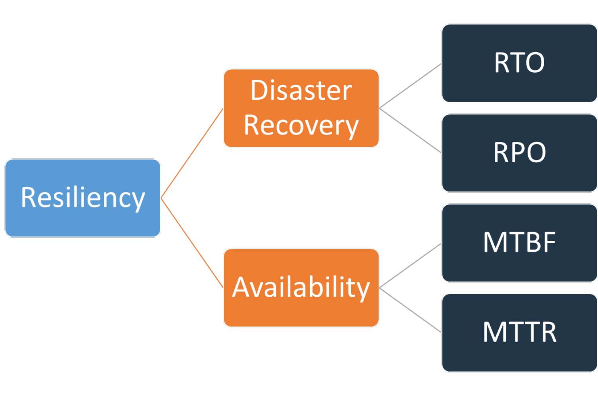
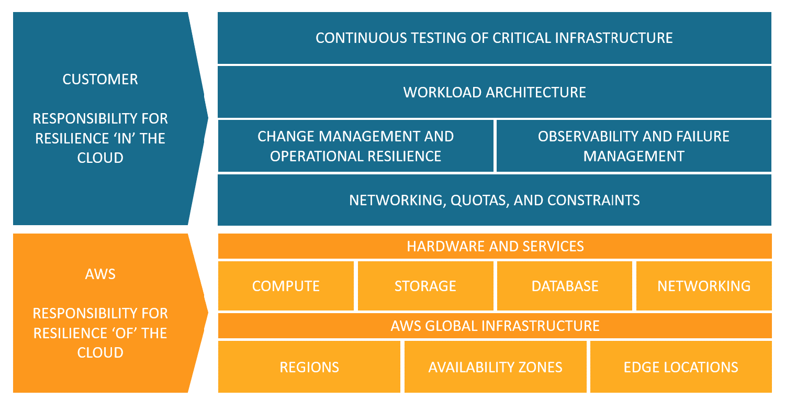
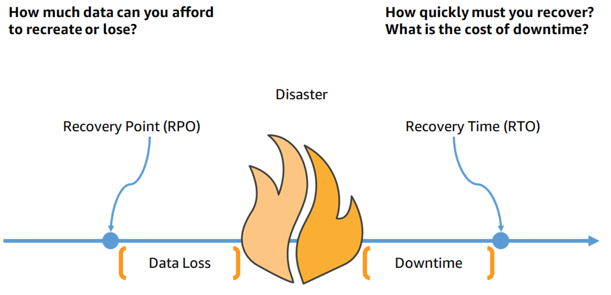
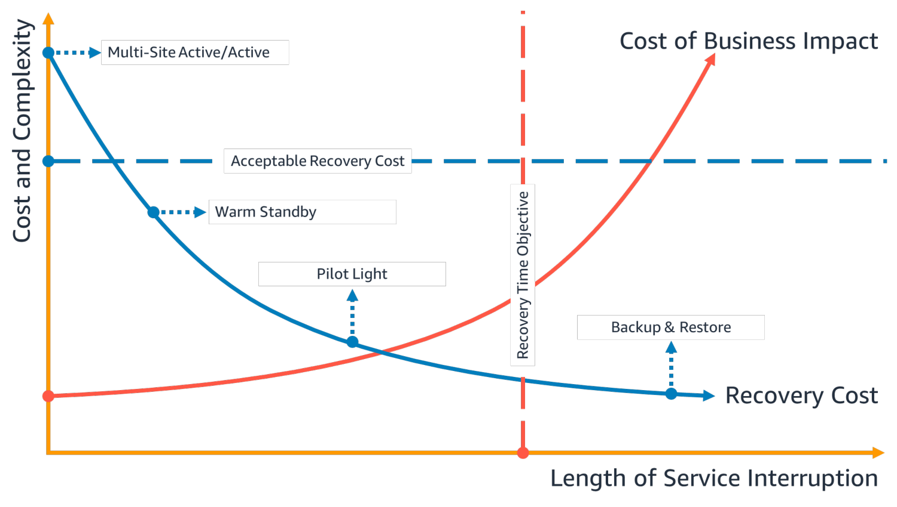
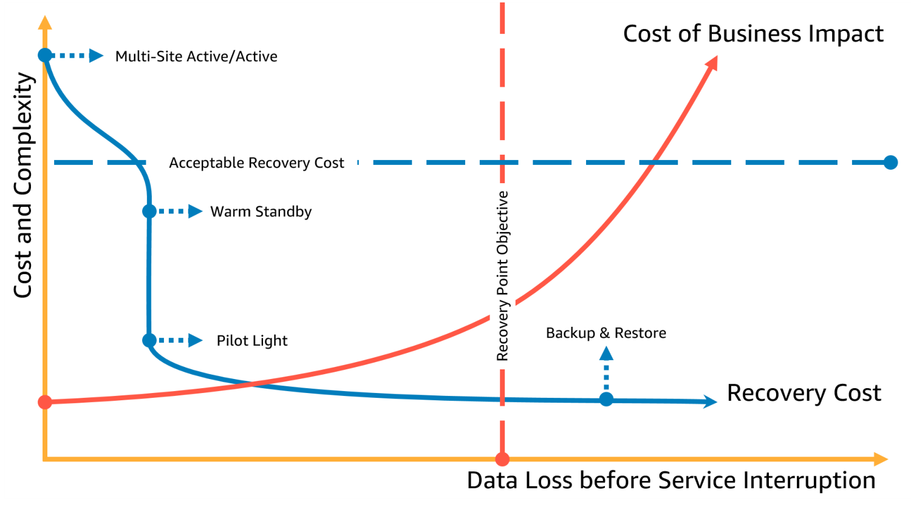

# Fundamentals: Disasters, Availability and Recovery Objectives

## What counts as a disaster

A disaster is any event that prevents a workload from fulfilling its business objectives in its primary deployed location. AWS groups disasters into three categories:

* **Natural disasters**: earthquakes, floods
* **Technical failures**: power failure, loss of network connectivity
* **Human actions**: inadvertent misconfiguration, unauthorised access or modification

Each disaster also has a geographic blast radius: local, regional, country-wide, continental or global. Both dimensions shape the strategy. A local flood that takes out a data centre is absorbed by a Multi-AZ architecture. An attack that corrupts production data follows your replication everywhere, and requires failing over to backup data in another Region.

In practice the human category dominates. Regional natural disasters are rare. Bad deploys, accidental deletions and compromised credentials are not.

## High availability is not disaster recovery

Availability and DR share some practices, such as monitoring, multi-location deployment and automatic failover, but they answer different questions.

| | Availability | Disaster recovery |
|---|---|---|
| Measures | Mean values over time (the "nines", from MTBF and MTTR) | Objectives for one-time events (RTO, RPO) |
| Protects | Components of the workload | Discrete copies of the entire workload |
| Handles | Component failures, network issues, software bugs, load spikes | Large-scale events that qualify as disasters |
| Goal | Maximise time the workload serves its function | Business continuity after a serious event |

The canonical failure mode: a storage layer continuously replicates to a second site for high availability. Someone deletes or corrupts files on the primary. Replication ships the destructive change to the secondary within seconds. The system is highly available and unrecoverable at the same time. The fix is point-in-time backup as part of the DR strategy, in addition to replication.

Sequence matters: meet availability objectives first, since a highly available architecture carries you through most events, then layer DR on top for the events availability cannot absorb.

## Shared responsibility for resiliency

* **AWS: resiliency of the cloud.** Hardware, software, networking and facilities. Regions are fully isolated. Availability Zones are physically isolated fault domains within a Region, connected by redundant dedicated metro fibre, encrypted in transit, with latency low enough for synchronous replication between zones.
* **Customer: resiliency in the cloud.** Scope depends on service choice. EC2 workloads require you to deploy across zones, implement self-healing with Auto Scaling, and build resilient applications. Managed services like S3 and DynamoDB shift infrastructure to AWS, but data resiliency, meaning backup, versioning and replication strategy, remains yours.

## The business continuity frame

A DR plan is a subset of the organisation's Business Continuity Plan, not a standalone document. Aggressive recovery targets are pointless if the disaster breaks parts of the business the workload depends on, the whitepaper's example being an earthquake that stops you shipping goods your eCommerce platform sells.

The inputs that set recovery objectives:

* **Business impact analysis**: quantifies the impact of a disruption on internal and external customers. Impact can be time dependent. Payroll down the day before payday is a crisis, the day after is an inconvenience.
* **Risk assessment**: probability of each disaster type given the workload's technical implementation and geography.
* **Cost evaluation**: each tightening of objectives costs more.

Two deliberately unglamorous conclusions follow. For some workloads, the correct decision is no DR at all, as an informed choice based on low probability or low value. And if the recovery strategy costs more than the failure or loss it prevents, it should not be built unless a secondary driver such as regulation requires it.

## RTO and RPO

* **Recovery Time Objective (RTO)**: the maximum acceptable delay between interruption of service and restoration of service. Defined by the organisation.
* **Recovery Point Objective (RPO)**: the maximum acceptable amount of time since the last data recovery point, which bounds acceptable data loss. Defined by the organisation.

Plotting the four DR strategies against cost and against each objective turns strategy selection into a constrained choice rather than a taste debate. In the whitepaper's worked example, the business ceiling on downtime and spend leaves pilot light and warm standby as the two strategies satisfying both RTO and cost, and the same two satisfy RPO and cost.

## Why DR is different in the cloud

Compared to a physical secondary data centre, DR on AWS offers:

* Faster recovery with reduced complexity
* Simple, repeatable testing, so you can test more often
* Lower management overhead
* Automation opportunities that cut error rates and recovery time
* Capital expense of a standby facility traded for variable operating expense of a rightsized environment

Single-Region options come first. Multi-AZ deployment plus continuous in-Region backup already mitigates most natural, technical and human threats, since zones are built with meaningful separation. Backing up data, configuration and infrastructure definitions to a second Region is a simple, inexpensive extension that shrinks the DR plan to data backup and restoration. Where data residency rules pin a workload to a single-Region locality, the multi-Region strategies in this repo can be implemented across Availability Zones instead of Regions.

For disasters that could take out an entire Region, the four multi-Region strategies apply. See the remaining documents.
