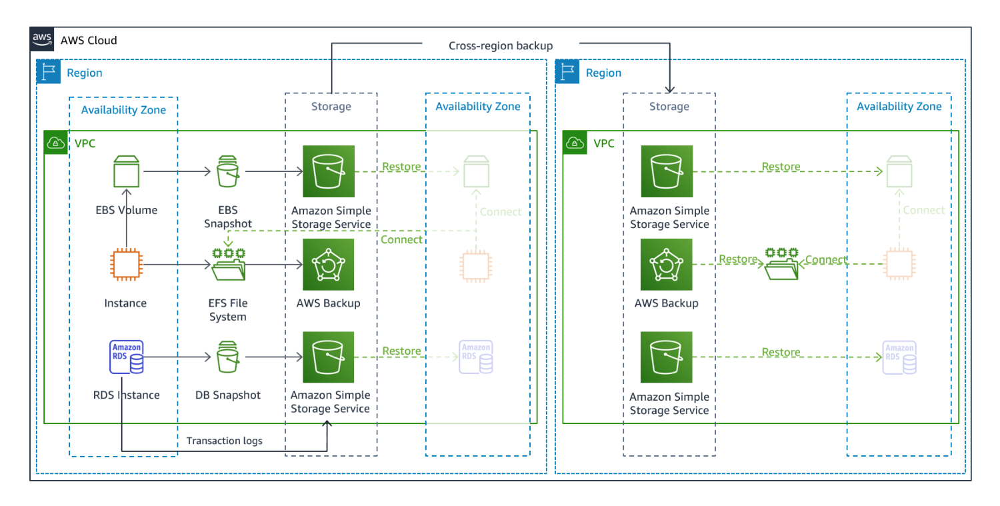
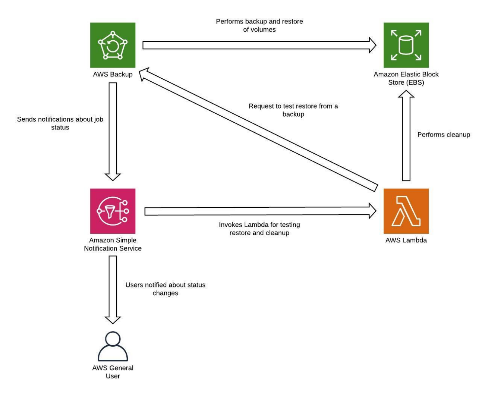

# Strategy 1: Backup and Restore

**Typical RPO/RTO: hours. Relative cost: $.**

Back up data, configuration and infrastructure definitions to the recovery Region. At failover, restore data and redeploy everything. Suitable for mitigating data loss or corruption anywhere, for regional disaster protection via cross-Region backup copies, and for workloads sitting in a single Availability Zone.

## Infrastructure is part of the backup

RPO is set by backup frequency. RTO is dominated by rebuild time, which is why the most important control in this strategy is not a storage feature, it is infrastructure as code. Define the entire workload in AWS CloudFormation or the AWS CDK so it can be redeployed to the recovery Region quickly and without error. Back up application code and configuration too, including the AMIs used to build EC2 instances, and automate redeployment with AWS CodePipeline. Without IaC, restoring in a fresh Region under pressure is slow and error prone, and the stated RTO is a fiction.

## Point-in-time backup services

Backup with point-in-time recovery is available for:

* Amazon EBS snapshots
* Amazon RDS and Aurora snapshots
* Amazon DynamoDB backup
* Amazon EFS backup (via AWS Backup)
* Amazon Redshift, Neptune and DocumentDB snapshots
* Amazon FSx for Windows File Server, Lustre, NetApp ONTAP and OpenZFS

**AWS Backup** centralises configuration, scheduling and monitoring across EBS volumes, EC2 instances, RDS and Aurora databases, DynamoDB tables, EFS file systems, Storage Gateway volumes and the FSx family. It copies backups across Regions and across accounts. Cross-account copies matter: they protect against insider threats and account compromise, disaster categories that in-account backups do not survive. For EC2, AWS Backup also records instance metadata (instance type, VPC, security group, IAM role, monitoring, tags), though that metadata only applies when restoring in the same Region.

## S3 specifics worth knowing

* **Cross-Region Replication (CRR)** copies objects asynchronously and continuously to a bucket in the DR Region, with versioning providing choice of restoration point.
* **Object versioning** retains the original version through deletions and modifications, a useful mitigation for human-error disasters.
* **Delete marker behaviour**: with replication configured, deleting an object in the source bucket adds a delete marker in the source bucket only by default. The DR Region copy survives malicious deletion in the source Region.

Continuous replication gives near-zero backup lag but does not protect against corruption or malicious deletion the way point-in-time backups do. You need both.

## Automate restoration, and test it continuously

Backups in the DR Region must be restored at failover time. AWS Backup offers restore but not scheduled automatic restoration, so implement it with the AWS SDK, either on a schedule or triggered on backup completion. The whitepaper's reference pattern uses Amazon SNS and AWS Lambda.

The reasoning is sharper than it first looks. Restoring from backup is a control plane operation, exactly the class of operation that may be unavailable during a serious event. A scheduled periodic restore means that even if the restore API is impaired mid-disaster, you already hold an operable data store built from a recent backup. It also means your backups are tested continuously rather than trusted theoretically.

## Cheapest storage for relaxed objectives

Backing up to S3 gives immediate retrieval. Where parts of the data tolerate retrieval times of minutes to hours, Amazon S3 Glacier or Glacier Deep Archive significantly reduce backup and recovery cost.

---
Source: AWS, [Disaster Recovery of Workloads on AWS: Recovery in the Cloud](https://docs.aws.amazon.com/whitepapers/latest/disaster-recovery-workloads-on-aws/disaster-recovery-workloads-on-aws.html). Diagrams © Amazon Web Services, Inc. or its affiliates.
