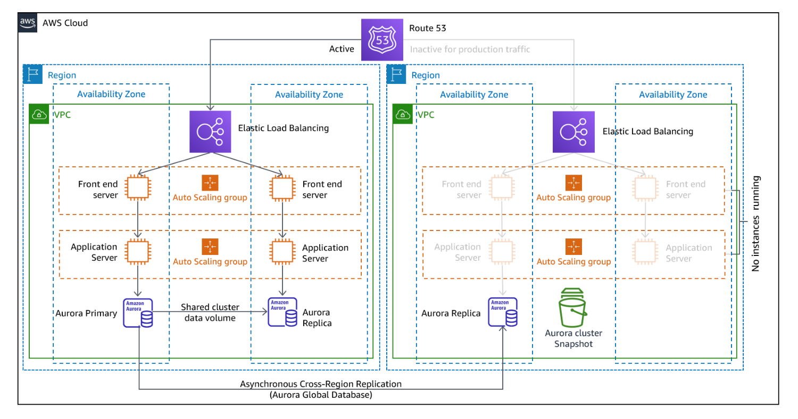
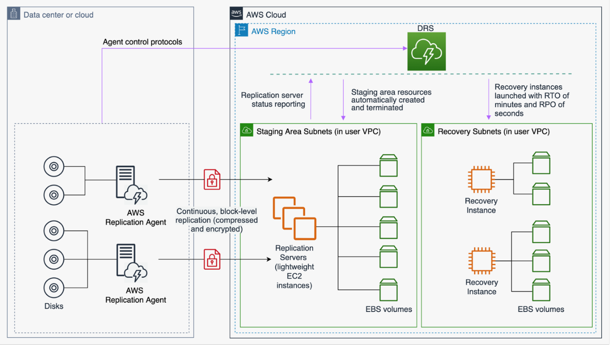

# Strategy 2: Pilot Light

**Typical RPO/RTO: tens of minutes. Relative cost: $$.**

Replicate data continuously to the DR Region and keep a copy of the core infrastructure provisioned there. Stateful resources that support replication, such as databases and object storage, are always on. Application servers carry the right code and configuration but are switched off, used only for testing or when failover is invoked. The best practice for "switched off" is not deploying the resource at all, and holding the configuration and capability to deploy it on demand.

## Continuous cross-Region replication services

Low RPO comes from continuous, asynchronous replication, used alongside the point-in-time backups from the backup and restore strategy, never instead of them:

* Amazon S3 Replication, with S3 Replication Time Control for monitoring replication times
* Amazon RDS read replicas
* Amazon Aurora global databases
* Amazon DynamoDB global tables
* Amazon DocumentDB global clusters
* Global Datastore for Amazon ElastiCache

**Aurora global database deserves its reputation here.** It replicates on dedicated infrastructure that leaves the database fully available to serve the application, with typical cross-Region latency under a second. If the primary Region degrades or fails, a secondary Region can be promoted to read/write in under a minute, even in a complete regional outage. Aurora can also monitor RPO lag across all secondary clusters so at least one stays within your target window. Promoting a non-Aurora RDS read replica works, but takes minutes and includes a reboot.

## One template, two shapes

Deploy the same infrastructure code everywhere, in two configurations: full scale in the primary Region, scaled down or switched off in the DR Region. CloudFormation pseudo parameters identify the account and Region at deploy time, so condition logic in one template produces both shapes. An EC2 Image Builder pipeline keeps golden AMIs current and copies them to both Regions, so the servers switched on in a disaster contain exactly what the production servers contain.

AWS recommends a separate account per Region, for the highest resource and security isolation, which matters when compromised credentials are part of the disaster scenarios you plan for.

## Failover and traffic routing

For active/passive strategies, all traffic goes to the primary Region until failover switches it. Two decisions matter: who initiates, and which plane the mechanism lives on.

**Automatic vs manual initiation.** Automatic failover on health checks sounds ideal, but recovery time and recovery point are always greater than zero, so failing over on a false alarm buys real availability and data loss for nothing. Many teams choose manually initiated failover where every step after the human decision is automated, so initiation is the push of a button.

**Routing options:**

* **Route 53 DNS failover on health checks**: automatic, and a highly reliable data plane operation.
* **Amazon Application Recovery Controller (ARC)**: for manual initiation, ARC provides Route 53 health checks that act as on/off switches under your full control, scriptable via a highly available data plane API.
* **Route 53 weighted routing changes**: shifting weights to the recovery Region works, but it is a control plane operation and less resilient than ARC.
* **AWS Global Accelerator**: anycast static IPs with automatic health-check-based routing and lower latency via the AWS edge network, avoiding DNS caching issues. Manual traffic dials, however, are control plane.
* **Amazon CloudFront origin failover**: per-request failover from primary to secondary origin, with subsequent requests still trying the primary.

## AWS Elastic Disaster Recovery

AWS Elastic Disaster Recovery (DRS) productises the pilot light pattern. It continuously replicates server-hosted applications and databases at block level from any source, on premises, another cloud, or EC2 itself (for workloads not using RDS), into a low-cost staging VPC. On failover, staged resources automatically become a full-capacity deployment in the recovery VPC.

---
Source: AWS, [Disaster Recovery of Workloads on AWS: Recovery in the Cloud](https://docs.aws.amazon.com/whitepapers/latest/disaster-recovery-workloads-on-aws/disaster-recovery-workloads-on-aws.html). Diagrams © Amazon Web Services, Inc. or its affiliates.
