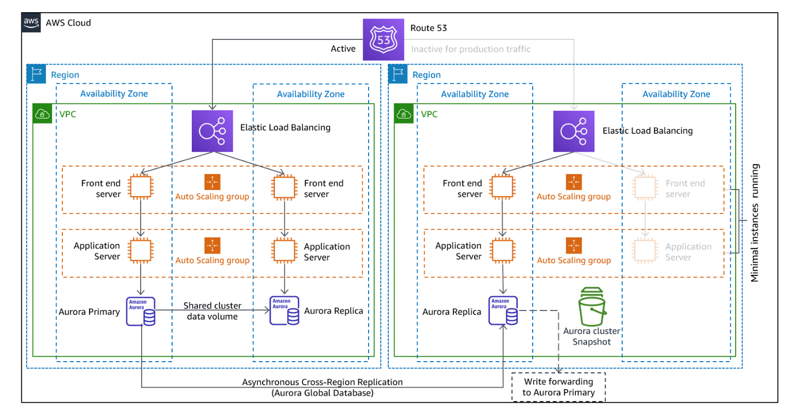

# Strategy 3: Warm Standby

**Typical RPO/RTO: minutes. Relative cost: $$$.**

Maintain a scaled-down but fully functional copy of the production environment in the DR Region. Everything is deployed and running, just smaller. At failover, scale up to full production capacity.

## Pilot light vs warm standby, precisely

The two are often confused because both keep an environment in the DR Region with copies of primary assets. The distinction:

* **Pilot light cannot process a request without action being taken first.** Servers must be turned on, non-core infrastructure may need deploying, then scale up.
* **Warm standby can handle traffic immediately**, at reduced capacity. The only remaining action is scaling up.

Choose between them on RTO and RPO needs. Warm standby also enables something pilot light cannot: continuous testing against a genuinely working end-to-end environment, which compounds confidence in recovery.

## Scaling up, and the control plane trade

All services from backup and restore and pilot light apply here for backup, replication, routing and deployment. Scaling the DR Region to production capacity uses Amazon EC2 Auto Scaling, which scales EC2 instances, ECS tasks, DynamoDB throughput and Aurora replicas within a Region. Raise the Auto Scaling group's desired capacity through the console, the SDK, or by redeploying the CloudFormation template with a new parameter value.

Two operational caveats carry more weight than they appear to:

1. **Service quotas in the DR Region must be high enough** to reach full production capacity. Quota requests are not something to discover mid-disaster.
2. **Auto Scaling is a control plane activity.** Taking a dependency on it lowers the resiliency of the whole recovery strategy. This is an explicit trade: fewer resources and lower cost against a control plane dependency in your most critical path.

## Hot standby and static stability

The alternative to the Auto Scaling dependency is provisioning the DR Region at full production capacity from the start. This statically stable configuration is called **hot standby**: a full-capacity active/passive setup where the second Region takes no production traffic until needed. A middle path some teams use is provisioning enough capacity for initial traffic to keep RTO low, then relying on Auto Scaling for the ramp.

In practice, most organisations that pay for a full-capacity second Region conclude they may as well serve traffic from it, which is the multi-site active/active strategy in the next document. If serving traffic from both Regions is not wanted, warm standby is usually the more economical and operationally simpler choice than hot standby.

---
Source: AWS, [Disaster Recovery of Workloads on AWS: Recovery in the Cloud](https://docs.aws.amazon.com/whitepapers/latest/disaster-recovery-workloads-on-aws/disaster-recovery-workloads-on-aws.html). Diagrams © Amazon Web Services, Inc. or its affiliates.
