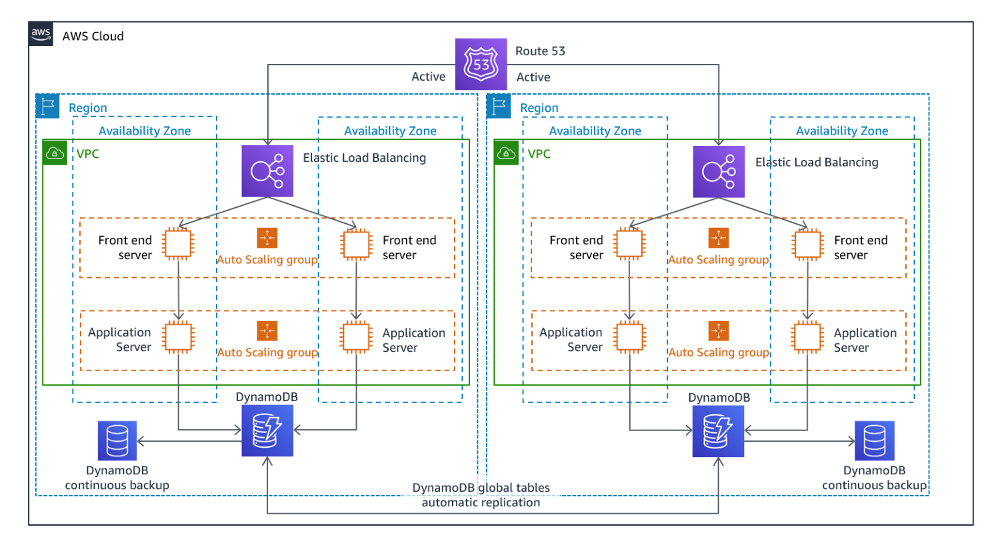

# Strategy 4: Multi-site Active/Active

**Typical RPO/RTO: near real time. Relative cost: $$$$.**

Run the workload simultaneously at full capacity in multiple Regions, all serving production traffic. Users are served from any deployed Region, typically the nearest. Losing a Region means routing traffic away from it and letting the others absorb the load. There is no failover event, because nothing is passive.

This is the most complex and expensive strategy, and with the right technology choices it brings recovery time near zero for most disasters. The honest caveat: data corruption still relies on backups, so the recovery point for a data disaster is always somewhere before the corruption was discovered, whatever the topology. If this level of complexity and cost is justified by near-zero recovery requirements, invest correspondingly in security and human-error prevention, because human disasters remain the ones replication cannot outrun.

## Routing across active Regions

Route 53 and AWS Global Accelerator both route users across active regional endpoints. Global Accelerator uses traffic dials to control the percentage of traffic per endpoint and onboards traffic to the AWS backbone at the nearest edge, lowering request latency. Route 53 supports percentage-based policies plus a wider set including latency and geoproximity routing.

## The hard problem is writes

Asynchronous replication enables near-zero RPO. Reads are usually served from the nearest Region, read local. Writes need one of three designs:

| Pattern | How it works | AWS fit | Design constraint |
|---|---|---|---|
| **Write global** | All writes go to one Region, promote another on failure | Aurora global database, with write forwarding so secondary clusters forward write SQL to the primary, promotion in under a minute | Write latency for distant users, promotion step on failure |
| **Write local** | Writes go to the nearest Region | DynamoDB global tables, read and write in every Region | Last-writer-wins reconciliation between concurrent updates, which must be consciously acceptable |
| **Write partitioned** | Writes routed by partition key, such as user ID, so each record has one home Region | Bi-directional S3 replication between two Regions, with replica modification sync enabled on both buckets so metadata changes (ACLs, tags, object locks) replicate | Partitioning scheme must hold under Region loss, delete marker replication configurable |

Aurora global database replicates to up to five secondary Regions with typical latency under a second, leaving the database fully available to serve the application while replicating.

Whatever the write pattern, point-in-time backups remain part of the strategy, protecting against corruption and destruction events that replication propagates.

## Hot standby, the sibling strategy

Hot standby runs the same full-capacity multi-Region deployment but keeps traffic on a single Region, active/passive. DR testing for active/active shifts focus accordingly: not "can we fail over" but "does traffic route away from a lost Region, and can the remaining Regions carry the full load". Backup and recovery still require regular testing of their own.

## Deploying consistently across Regions

AWS CloudFormation enforces consistent infrastructure across accounts and Regions. **CloudFormation StackSets** extends this with create, update and delete of stacks across multiple accounts and Regions in one operation. The AWS CDK offers the same outcomes in familiar programming languages, synthesising to CloudFormation.

---
Source: AWS, [Disaster Recovery of Workloads on AWS: Recovery in the Cloud](https://docs.aws.amazon.com/whitepapers/latest/disaster-recovery-workloads-on-aws/disaster-recovery-workloads-on-aws.html). Diagrams © Amazon Web Services, Inc. or its affiliates.
